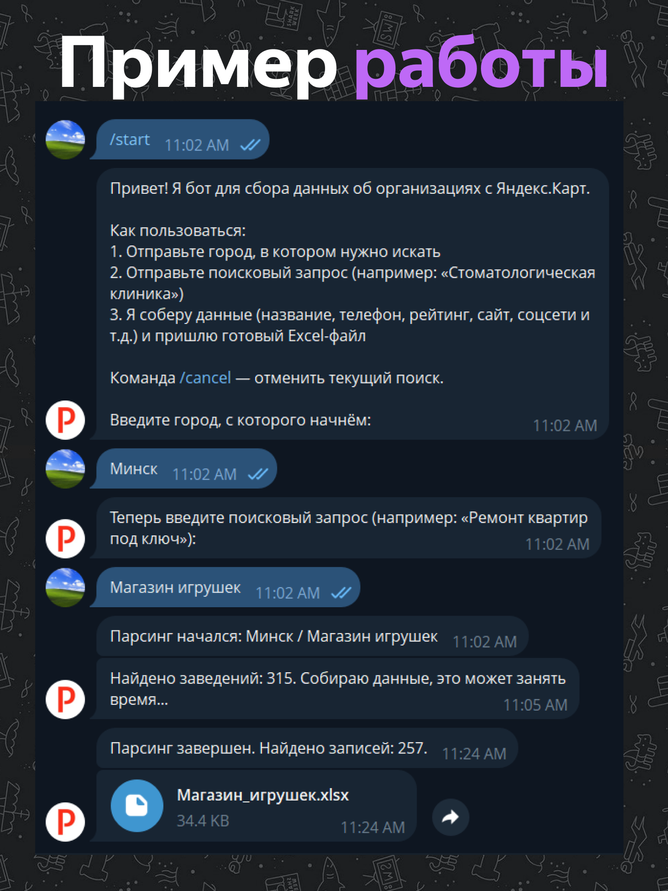
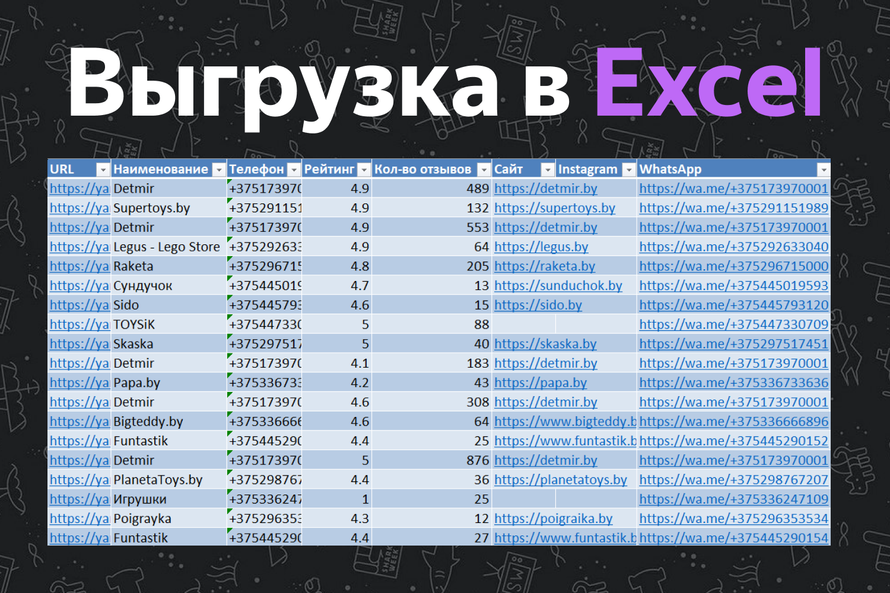

# Parser Yandex Maps by City and Query
Telegram bot for automatic data collection from Yandex.Maps. The user launches the bot, indicates the city and search query - the bot collects information about organizations (name, phone number, website, social networks, rating) and sends the finished Excel file. The bot also automatically removes duplicates to keep your data clean and ready to use.





## Run
### Paste your token
```
BOT_TOKEN=
```
### and
```bash
pip install -r requirements.txt
python bot.py
```
